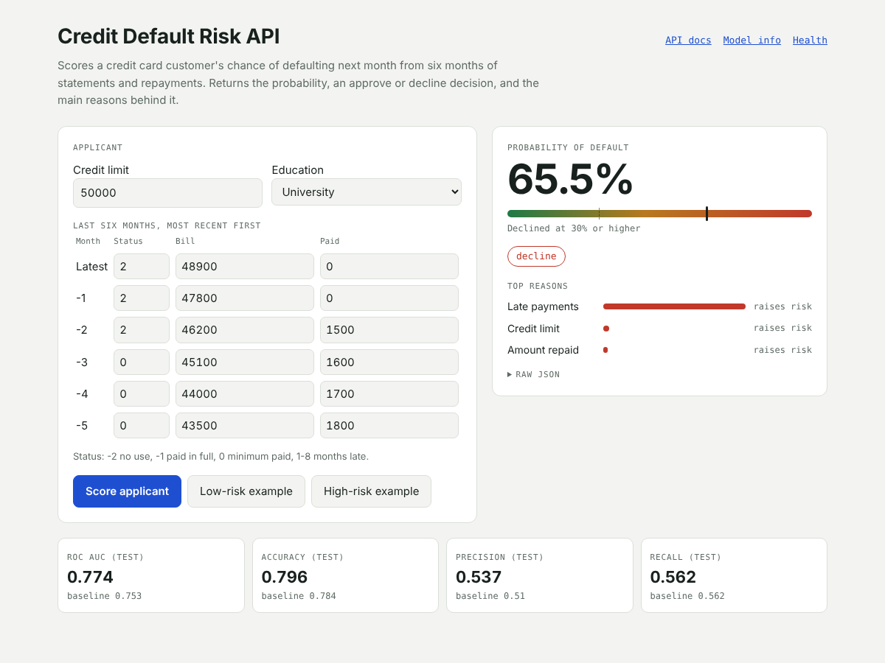

# Credit Default Risk API

Predicts the chance that a credit card customer **won't pay their bill next month**. It gives an approve or decline decision and the main reasons behind it.

Built with **Python, LightGBM, FastAPI and Docker**.

**Live demo:** `https://<your-space>.hf.space` · **API docs:** `/docs`



New to the code? Read **[HOW_IT_WORKS.md](HOW_IT_WORKS.md)** for a plain-English walkthrough of every file.

## Results

Tested on 4,800 customers the model never saw during training:

| Metric | LightGBM | Baseline (logistic regression) |
|---|---|---|
| ROC AUC | **0.774** | 0.753 |
| Accuracy | **0.796** | 0.784 |
| Precision | **0.537** | 0.510 |
| Recall | 0.562 | 0.562 |

- Sex, marital status and age are **not** used as inputs.
- The model is about equally accurate for men (0.78 ROC AUC) and women (0.77).

## Try the API

```bash
curl -X POST https://<your-space>.hf.space/predict \
  -H "Content-Type: application/json" \
  -d '{
    "credit_limit": 50000,
    "education": "university",
    "status": [2, 2, 0, 0, 0, 0],
    "bills": [46990, 48233, 49291, 28314, 28959, 29547],
    "paid": [0, 2019, 1200, 1100, 1069, 1000]
  }'
```

Answer:

```json
{
  "probability_of_default": 0.592,
  "decision": "decline",
  "top_reasons": [
    {"reason": "Late payments", "effect": "raises risk", "strength": 1.938},
    {"reason": "Credit limit", "effect": "raises risk", "strength": 0.054},
    {"reason": "Credit used", "effect": "lowers risk", "strength": 0.039}
  ]
}
```

Lists hold 6 months, most recent first. In `status`, -2 means the card wasn't used, -1 paid in full, 0 paid the minimum, and 1–8 means that many months late.

## Run it on your computer

```bash
pip install -r requirements-dev.txt
python train.py          # optional: retrain the model
pytest                            # run the tests
uvicorn main:app --reload     # open http://localhost:8000
```

## Project files

Everything sits in one folder:

```
features.py        prepares the data (used by training and the API)
predict.py         loads the model and scores a customer
main.py            the web API
index.html         the demo page
train.py           trains and tests the model
model.txt          the saved model
model_info.json    the model's test results
test_api.py        automatic checks
Dockerfile         instructions to run it on a server
```

## Data

[Default of Credit Card Clients](https://archive.ics.uci.edu/dataset/350/default+of+credit+card+clients): 24,000 credit card customers in Taiwan, 2005.
